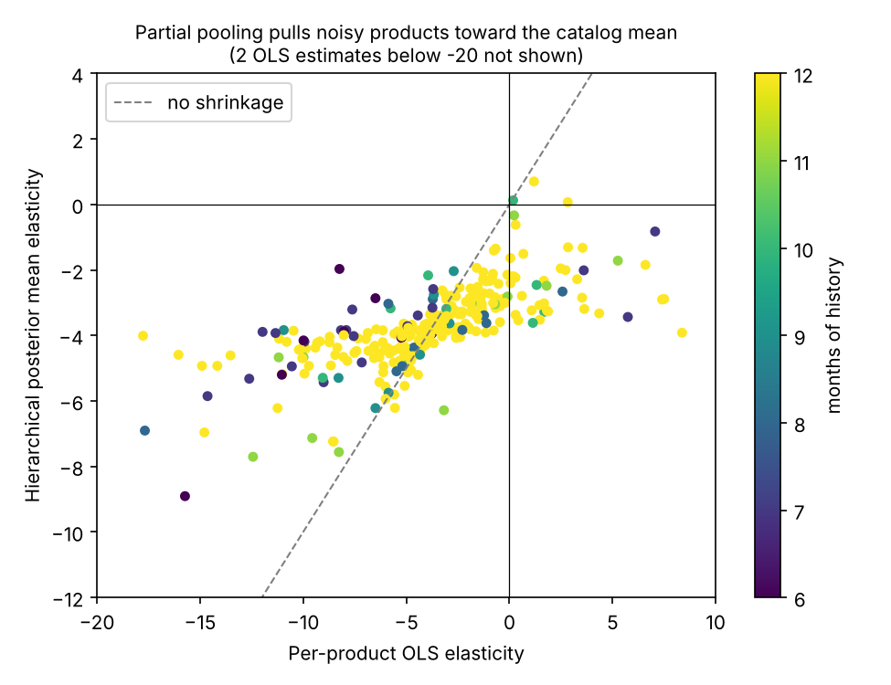

# PriceCurve: Hierarchical Bayesian Price Elasticity and Promo Optimization

**Question.** With a fixed promo budget, which products should be discounted, and by how much? Most products
have about a year of monthly sales, too little to estimate each one's price sensitivity on its own.

**Data.** UCI Online Retail (Chen, 2015), 541,909 real transaction lines from a UK online retailer,
Dec 2010 to Dec 2011. `data/download.sh` fetches it and verifies its SHA-256.

## Results (`results/*.json`)

| Step | Result |
|---|---|
| Cleaning | 541,909 lines -> 460,467 (cancellations, non-positive rows, non-UK, postage/fee codes, partial Dec 2011 removed) -> 31,244 product-months |
| Modeling set | Top 300 products by revenue (55.8% of revenue), 3,352 product-months, median 12 months each |
| Sampler health | 4 chains x 1,000 draws, **0 divergences**, max R-hat 1.010, min ESS 293 |
| Catalog elasticity | **-3.75** (94% interval -4.13 to -3.38); holiday lift +0.63 on log quantity |
| Why pooling | Per-product OLS gives the wrong sign (demand rising with price) for **13.7%** of products; the hierarchical model for **1.0%** |
| Optimizer (PuLP MIP, GBP 5,000 budget) | Discounts 11 of 300 products by 10%; **GBP 21,227** projected incremental revenue |
| Versus uniform discount | Best uniform discount that fits the same budget (0.5%) yields GBP 9,218, so targeting yields **130% more** |
| Under elasticity uncertainty | Plan re-scored over 4,000 posterior draws: incremental revenue GBP 17,317 to 26,613 (5th to 95th percentile), never negative; but promo cost exceeds the budget in **53%** of draws |

## Method

1. `src/prepare_data.py`: clean, aggregate to product-month (quantity-weighted average price), keep products with
   6+ months, center log price within each product.
2. `src/model_bayesian.py`: `log(qty) = alpha_p + beta_p * centered log(price) + gamma * NovDec`, with `alpha_p`
   and `beta_p` drawn from shared population distributions (non-centered). Fits per-product OLS on the same data
   for comparison.
3. `src/optimizer.py`: one discount level per product (0/10/20/30%), maximize incremental revenue subject to the
   budget, using the same constant-elasticity response as the model. Baseline is each product's last full month
   (Nov 2011 for 296 of 300).
4. `src/plot.py`: the shrinkage chart above.

Run everything: `pip install -r requirements.txt && bash run.sh` (about a minute on a laptop CPU).

## Limitations

- **Elasticities are observational and likely overstated.** This retailer sells largely to wholesale buyers with
  quantity-break pricing, so a lower average price in a month partly reflects bigger orders, not customers
  responding to a price cut. A -3.75 catalog elasticity is high for retail; treat the optimizer's revenue
  projections as an upper bound until tested with a randomized price experiment.
- The optimizer plans on posterior-mean elasticities, so it ignores uncertainty; the posterior check shows the
  plan overspends the budget about half the time. A production version would add a budget buffer or optimize
  expected value over draws.
- Constant elasticity is only trustworthy near observed prices; the selected 10% discounts stay inside that range.
- One year of data, so trend and seasonality cannot be fully separated.
